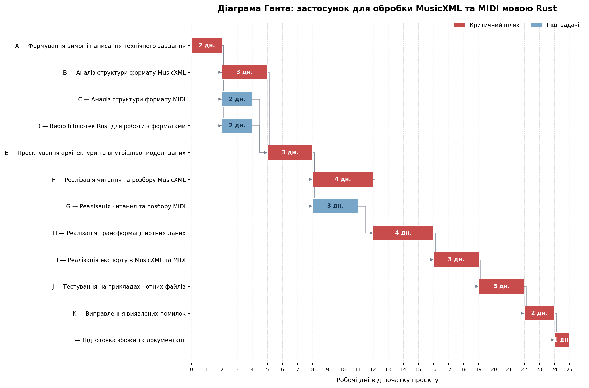

**Лабораторна робота № 8**

**Тема:** Побудова розкладу та діаграми Ганта (Gantt Chart)

Практика календарного планування проєкту в парадигмі Waterfall. Встановлення логічних залежностей між задачами, побудова діаграми Ганта та обчислення Критичного шляху (Critical Path).

**Мета:** Навчитися перетворювати список пакетованих робіт (WBS) у часовий графік, розуміти типи зв'язків між задачами та визначати послідовність найважливіших дій (Критичний шлях), затримка в яких зірве терміни всього проєкту.

**Технологічний стек:** Будь-яка програма для Гант-чартів: MS Project, GanttProject (безкоштовна), TeamGantt, Jira Timeline, або Excel / Google Sheets (з умовним форматуванням).

**Тема:** Розробка додатку для обробки та трансформації нотних даних у форматах MusicXML та MIDI мовою Rust

**Крок 1. Аналіз та визначення залежностей**

У межах проєкту потрібно проаналізувати формати MusicXML і MIDI, обрати інструменти Rust, спроєктувати спільну модель нотних даних, реалізувати читання, трансформацію та збереження файлів, а потім протестувати застосунок.

| **ID** | **Назва задачі** | **Тривалість (дні)** | **Попередники (Predecessors)** |
|:--:|----|----|----|
| A | Формування вимог і написання технічного завдання | 2 | --- |
| B | Аналіз структури формату MusicXML | 3 | A |
| C | Аналіз структури формату MIDI | 2 | A |
| D | Вибір бібліотек Rust для роботи з форматами | 2 | A |
| E | Проєктування архітектури та внутрішньої моделі нотних даних | 3 | B, C, D |
| F | Реалізація читання та розбору MusicXML | 4 | E |
| G | Реалізація читання та розбору MIDI | 3 | E |
| H | Реалізація трансформації нотних даних | 4 | F, G |
| I | Реалізація експорту в MusicXML та MIDI | 3 | H |
| J | Тестування на прикладах нотних файлів | 3 | I |
| K | Виправлення виявлених помилок | 2 | J |
| L | Підготовка збірки та документації | 1 | K |

Задачі B, C і D можна виконувати паралельно після завершення A. Після них створюється спільна модель даних (E). Читання MusicXML (F) і MIDI (G) також можна реалізовувати паралельно. Трансформація (H) залежить від готовності обох модулів читання.

**Крок 2. Діаграма Ганта**

{width="6.69375in" height="4.420138888888889in"}

**Крок 3. Критичний шлях і тривалість проєкту**

Критичний шлях:

**A → B → E → F → H → I → J → K → L**

Тривалість критичного шляху:

**2 + 3 + 3 + 4 + 4 + 3 + 3 + 2 + 1 = 25 робочих днів.**

Отже, мінімальна запланована тривалість проєкту за наведеними оцінками становить **25 робочих днів**, якщо задачі виконуються за планом, а незалежні роботи розпаралелюються.

**Контрольні запитання**

**1. Поясніть своїми словами, що таке "Залежність Finish-to-Start (FS)". Наведіть приклад з реального життя (не з IT).**

Це залежність, за якої наступну роботу можна почати лише після повного завершення попередньої. Наприклад, стіну можна фарбувати тільки після того, як завершено її шпаклювання і підготовку.

**2. Що таке "Критичний шлях" (Critical Path) на Діаграмі Ганта і чому Project Manager повинен слідкувати за задачами на ньому щодня?**

Критичний шлях --- це найдовший за тривалістю ланцюжок залежних задач, який визначає загальний строк проєкту. Задачі на цьому шляху не мають резерву часу, тому навіть невелика затримка може відкласти завершення всього проєкту. Менеджеру потрібно регулярно перевіряти їхній стан і вчасно усувати перешкоди.

**3. Чи можлива ситуація, коли в проєкті існує відразу ДВА паралельних критичних шляхи? Що це означає для ризиків проєкту?**

Так, у проєкті можуть існувати відразу два паралельних критичних шляхи. Це означає, що два різні ланцюжки задач мають однакову найбільшу тривалість і визначають загальний термін завершення проєкту.

Для ризиків це означає, що потрібно уважно контролювати обидва шляхи, адже затримка будь-якої задачі на одному з них може призвести до затримки всього проєкту. Тобто чим більше критичних шляхів, тим вищий ризик порушення термінів.

**4. Якщо задача "Копірайтинг" не лежить на критичному шляху і має "Резерв часу" (Float) у 3 дні, що станеться з фінальною датою релізу проєкту, якщо копірайтер запізниться зі здачею текстів на 2 дні?**

Дата релізу не зміниться, оскільки затримка на 2 дні вкладається в резерв у 3 дні. Після цього залишиться ще 1 день резерву, за умови що немає інших затримок.

**5. Чому Діаграму Ганта практично неможливо і неефективно використовувати для управління інноваційними стартапами, які розробляються за методологією Scrum?**

У Scrum вимоги та пріоритети можуть змінюватися після кожного спринту, а команда планує роботу короткими ітераціями. Через це детальний графік на весь проєкт швидко стає застарілим і потребує постійного перегляду.
