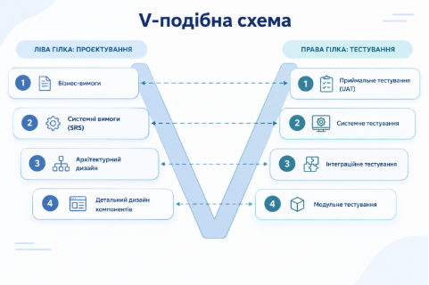
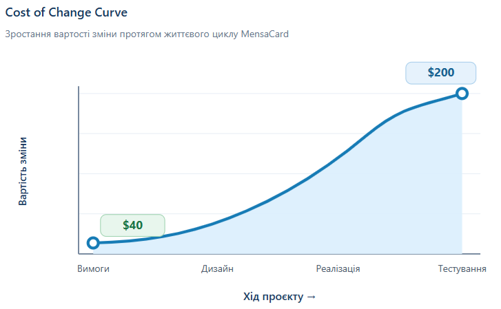


# **Лабораторна робота №4 (2 години)**
**Тема:** Моделювання процесів каскадної моделі (Waterfall) та V-моделі

Практика управління проєктом за традиційними предиктивними методологіями: формалізація фаз життєвого циклу SDLC, визначення контрольних точок переходу (Quality Gates / Sign-off), побудова матриці верифікації та валідації (V-Model) і аналіз ризиків контракту Fixed-Price.

**Мета:** Навчитися проєктувати строгу послідовність етапів каскадної моделі розробки, зіставляти рівні проєктування з відповідними рівнями тестування (V-Model) та оцінювати вплив змін (Change Request) на вартість і строки в проєктах із фіксованим бюджетом.

**Технологічний стек:** Google Docs / Microsoft Word / Draw.io / Miro / Excel (для побудови схем та матриць відповідності).

-----
## **Завдання**
Ви продовжуєте розвивати свій навчальний IT-проєкт (з Лабораторних робіт №1 та №2) або берете технічно критичну підсистему (наприклад, банківський платіжний шлюз, медичний сервіс розрахунку дозування ліків або модуль автентифікації), де критично важливі передбачуваність, документація та суворий контроль якості.

Вам необхідно спланувати життєвий цикл розробки цього модуля за предиктивною моделлю (Waterfall), побудувати матрицю контролю якості V-моделі та проаналізувати наслідки зміни вимог на фінальному етапі.
### **Перелік завдань:**
1. Описати фази життєвого циклу проєкту за моделлю Waterfall із визначенням Quality Gates (Sign-off).
1. Побудувати матрицю відповідності рівнів розробки та рівнів тестування за V-моделлю (Verification & Validation Matrix).
1. Змоделювати сценарій пізнього запиту на зміну (Change Request) в умовах контракту Fixed-Price та оцінити зростання вартості змін (Cost of Change Curve).

**Крок 1. Моделювання фаз каскадної моделі (Waterfall SDLC)** 

MensaCard має перевіряти валідність університетської картки, розраховувати вартість замовлення, перевіряти баланс, списувати кошти, зберігати чек і передавати дані про продажі до бухгалтерської системи. Основні стейкхолдери — студенти, працівники університету, касири, адміністрація, бухгалтерія та команда розробки.

|**Фаза Waterfall**|**Вхідні артефакти (Inputs)**|**Відповідальна роль**|**Результат і критерій завершення (Quality Gate / Sign-off)**|
| :- | :- | :- | :- |
|1\. Вимоги|Бізнес-кейс і Project Charter з ЛР №1; інтерв’ю зі стейкхолдерами; опис поточного процесу оплати; бізнес-правила та обмеження|Business Analyst за участі замовника й представників їдальні|Підготовлено SRS із функціональними та нефункціональними вимогами, сценаріями помилок і критеріями приймання. **Quality Gate:** замовник і спонсор затвердили SRS; неоднозначні вимоги опрацьовані до переходу далі.|
|2\. Проєктування|Затверджений SRS; вимоги до безпеки й обліку транзакцій|Solution Architect|Підготовлено архітектурну специфікацію, діаграми компонентів і послідовностей, ERD, контракти API та опис інтеграції з бухгалтерською системою. **Quality Gate:** Architecture Review завершено, рішення й інтерфейси погоджено.|
|3\. Реалізація|Затверджена архітектура, Entity-Relationship Diagram, API-контракти, правила кодування|Dev Team |Реалізовано модулі перевірки картки, розрахунку суми, перевірки балансу, списання та створення чека.; Готується код; зміни коду проходять code review; розробники створюють Unit-тести. **Quality Gate:** збірка успішна, критичні Unit-тести проходять, код перевірено й передано на тестування.|
|4\. Тестування|Реліз версії, архітектурна документація, тест-план і тест-кейси|QA Engineer / команда |Виконано інтеграційні, системні та регресійні тести; результати зіставлено з вимогами SRS; дефекти зареєстровано й класифіковано. **Quality Gate:** оформлено Test Summary Report, немає відкритих критичних дефектів, критерії виходу виконано.|
|5\. Розгортання|Перевірена реліз-версія, Test Summary Report, інструкції, документація користувача|DevOps та Project Manager; замовник і представники їдальні|Систему розгорнуто, перевірено конфігурацію, резервне копіювання й моніторинг; проведено User Acceptance Testing. **Quality Gate:** акт приймання-передачі; реліз передано в експлуатацію, визначено порядок супроводу.|

У Waterfall перехід між фазами відбувається після затвердження результатів попередньої фази. Якщо Quality Gate (контрольну точку) не пройдено, дефекти або невідповідності потрібно усунути до формального переходу далі.

**Крок 2. Побудова матриці відповідності V-моделі (Verification & Validation)** 

Для MensaCard кожному рівню проєктування відповідає рівень тестування. Тестування планується під час підготовки відповідних вимог і дизайну, а виконується після реалізації компонентів.

|**Рівень розробки (ліва гілка V)**|**Артефакт для MensaCard**|**Відповідний рівень тестування (права гілка V)**|**Що перевіряється**|
| :- | :- | :- | :- |
|**1. Бізнес-вимоги**|Бізнес-ціль — швидка й коректна оплата їжі університетською карткою; правила обслуговування студентів і працівників; критерії успішного платежу|**User Acceptance Testing (UAT)**|Чи відповідає система реальному процесу їдальні; чи можуть визначені користувачі завершити оплату й отримати чек; чи приймає замовник результат.|
|**2. Системні вимоги (SRS)**|Функціональні вимоги до перевірки картки, обчислення суми, перевірки балансу, списання коштів і збереження чека; нефункціональні вимоги до безпеки, надійності та часу відповіді|**System Testing (Системне)**|Чи працює система як єдине ціле й відповідає SRS; чи коректні успішні платежі та відмови за невалідної картки або недостатнього балансу; чи виконуються вимоги безпеки й продуктивності.|
|**3. Архітектурний дизайн**|Діаграми компонентів і послідовностей; взаємодія платіжного модуля, сховища транзакцій і бухгалтерської системи; ERD та контракти API|**Integration Testing (Інтеграційне)**|Чи правильно взаємодіють модулі; чи узгоджені формати й статуси відповідей API; чи зберігаються транзакції та передаються дані про продажі без втрат і дублювання.|
|**4. Детальний дизайн компонентів**|Алгоритми перевірки картки та балансу, розрахунку суми, списання коштів і формування чека; специфікації класів і методів|**Unit Testing (Модульне)**|Чи правильно працює кожна функція окремо, зокрема граничні випадки: нульова сума, недостатній баланс, невалідна картка та помилка запису.|

Верифікація відповідає на питання, чи відповідає реалізація специфікаціям і дизайну. Валідація перевіряє, чи розв’язує готовий продукт задачу користувача. У V-моделі рівні з’єднані попарно, тому простежуваність вимог до тестів допомагає перевірити, що кожна важлива вимога має відповідну перевірку.

## **Крок 3. Моделювання запиту на зміну (Change Request) та крива вартості помилки**
## **3.1. Умови**
## У початкових вимогах MensaCard передбачено перевірку університетської картки, розрахунок вартості замовлення, перевірку балансу, списання коштів і збереження чека. Контракт Fixed-Price становить $40 000 на 4 місяці.
## Наприкінці третього місяця, під час тестування, замовник просить додати можливість скасувати помилково проведений платіж і повернути кошти на університетську картку.
## Це нова функція, яка потребує змін у логіці платежів, обліку транзакцій і тестуванні. Через це можуть зрости вартість і термін виконання проєкту.
##
### **3.2. Аналіз впливу (Impact Analysis)**
Через додавання функції повернення коштів потрібно переглянути такі етапи V-моделі: бізнес-вимоги, SRS, архітектуру та детальний дизайн.

Необхідно оновити SRS, за потреби ERD та контракти API, змінити код і додати тест-кейси. Після цього провести повторне та регресійне тестування.
### **3.3. Оцінка додаткових витрат (Cost of Change)**
Крива показує, що чим пізніше виявлено потребу в зміні, тим дорожче її реалізувати. На етапі вимог зміна коштує приблизно $40, оскільки потрібно лише уточнити документацію. На етапі тестування вона коштує $200, адже необхідно змінювати готовий код і повторно тестувати систему. Це підтверджує важливість узгодження вимог на початку проєкту.

### **3.4. Рішення керівника проєкту (Change Request Form)**
**Запит 01:** додати можливість скасування платежу та повернення коштів.

**Вплив:** +$200 до бюджету, +1 місяць до терміну.

**Рішення:** перенести функцію до наступної версії Release 2.0.

**Обґрунтування:** це дозволить завершити поточний реліз у межах початкового бюджету $40 000 і терміну 4 місяці. Зміну потрібно погодити із замовником.
### **Висновок**
Пізні зміни збільшують витрати й затримують проєкт. Тому в Waterfall їх потрібно формально погоджувати, а непершочергові функції доцільно переносити до наступного релізу.

|**Поле**|**Заповнення**|
| :-: | :-: |
|ID запиту|01|
|Ініціатор|Замовник|
|Опис зміни|Додати скасування помилкового платежу та повернення коштів на картку.|
|Поточний стан|Кінець 3-го місяця, етап тестування. Бюджет — $4 000 на 4 місяці.|
|Оцінка впливу|Вартість зміни — $200 замість $40 на етапі вимог; затримка — до 1 місяця.|
|Рішення PM|Перенести функцію до Release 2.0.|
|Обґрунтування|Це допоможе завершити поточну версію в початкові строки й у межах бюджету.|
|Затвердження|Замовник погоджує рішення, PM оновлює план.|

# **Контрольні запитання**
1\. У чому полягає принципова різниця між верифікацією (Verification) та валідацією (Validation)?

Верифікація (Verification) перевіряє, чи правильно створюється продукт і чи відповідає результат специфікаціям, дизайну та вимогам. Валідація (Validation) перевіряє, чи створено саме той продукт, який потрібен користувачу, і чи розв’язує він його реальну задачу.

2\. Чому каскадна модель розробки (Waterfall) погано адаптується до частих змін бізнес-вимог ринку?

Waterfall передбачає попереднє узгодження вимог і послідовне проходження фаз. Пізня зміна зачіпає вже затверджені документи, архітектуру, код і тести, тому потребує формального Change Request, повторного погодження, додаткових витрат і може затримати реліз.

3\. Що таке “Quality Gate” (контрольний шлюз) та яка роль підпису стейкхолдера (Sign-off) у предиктивних моделях?

Quality Gate — це контрольна точка з визначеними критеріями, які мають бути виконані перед переходом до наступної фази. Sign-off — формальне підтвердження уповноваженого стейкхолдера, що результат прийнято. Воно фіксує спільне розуміння обсягу й відповідальності та зменшує ризик суперечок щодо того, що саме було погоджено.

4\. За яких умов в сучасному IT вибір Waterfall та V-Model є більш виправданим, ніж гнучких методологій Agile/Scrum?

Вони доречні, коли вимоги достатньо стабільні й детально визначені, бюджет і строки фіксовані, потрібні формальна документація та аудит, зміни мають суворо погоджуватися, а помилки можуть мати значні наслідки — наприклад, у медичних, банківських, державних або інших регульованих системах. V-модель особливо корисна, коли для кожного рівня вимог потрібно заздалегідь визначити відповідний рівень тестування.
## **Критерії оцінювання**
- Опис 5 фаз Waterfall SDLC із зазначенням Quality Gates: до 35 балів;
- Побудова та аргументація матриці відповідності V-моделі: до 35 балів;
- Якісний розбір кейсу Change Request та аналіз кривої вартості помилки: до 20 балів;
- Чіткі відповіді на контрольні запитання: до 10 балів.

